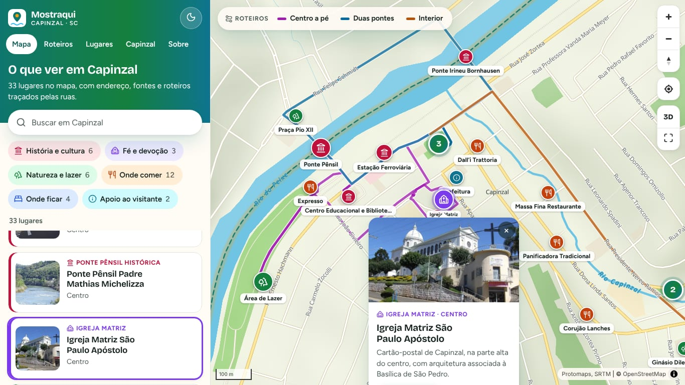
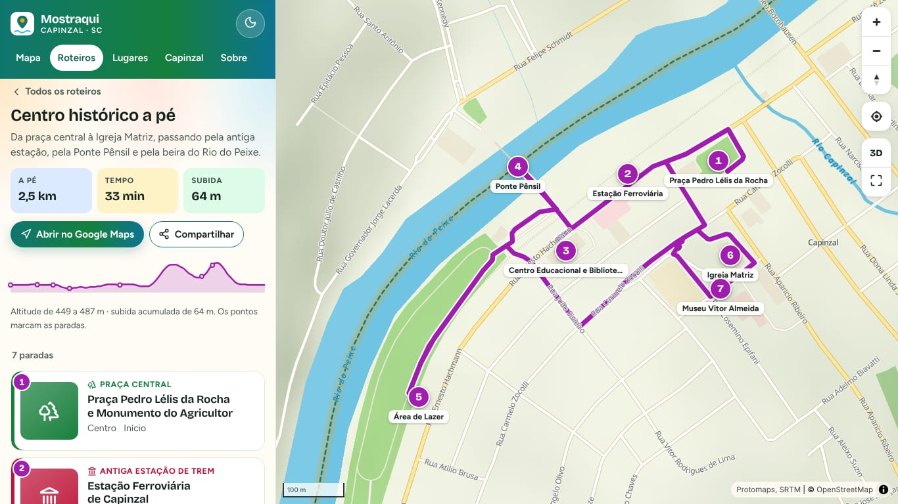
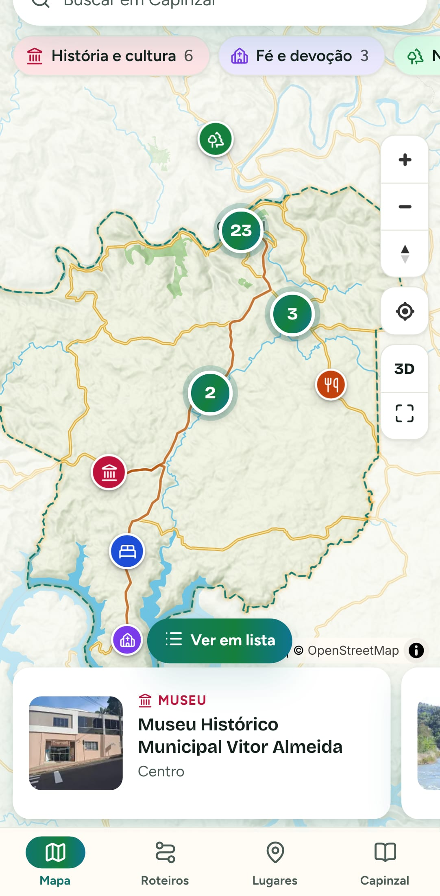

# Mostraqui Capinzal — mapa turístico interativo

Aplicativo web com o mapa turístico de **Capinzal (SC)**: lugares para visitar, onde comer, onde ficar e
roteiros traçados pelas ruas reais. Publicado em **mostraqui.net**. Funciona no celular, pode ser
instalado como aplicativo e abre **mesmo sem internet**.



| Roteiro com paradas numeradas e perfil de altitude | No celular |
| --- | --- |
|  |  |

## O que o aplicativo tem

- **Mapa próprio da região**, guardado no próprio site: nenhum pedido a serviços de mapas de terceiros,
  sem chave de API e sem custo por acesso. Tem relevo sombreado, vista em 3D e tema claro e escuro.
- **33 lugares**, cada um com página própria: descrição, endereço, contato, posição no mapa (com aviso
  quando é aproximada), botão "Como chegar" e **as fontes de cada informação**.
- **3 roteiros** calculados sobre as ruas do OpenStreetMap, com distância, tempo, paradas numeradas e
  perfil de altitude: centro histórico a pé, volta das duas pontes e interior de carro.
- **Busca e filtros** por categoria, botão "onde estou" com a distância até cada lugar.
- **Página da cidade** com dados do IBGE, história, acessos e calendário de eventos, tudo com fonte.
- **Modo sem internet:** depois da primeira visita, as páginas e o mapa ficam guardados no aparelho.
- **Privacidade:** sem cadastro, sem cookies e sem rastreamento.
- **Guia independente:** iniciativa particular, sem vínculo oficial com a Prefeitura. Correções:
  `contato@mostraqui.net`.
- **Acessibilidade:** meta WCAG 2.2 nível AA, com lista equivalente ao mapa, uso por teclado e
  contrastes calculados.

## Regra de ouro dos dados

Nenhuma informação entra sem fonte. O comando `npm run conferir` (executado antes de cada montagem)
recusa lugares sem fonte, fotos sem licença, posições fora do município e roteiros que não passam
pelas paradas. Restaurantes e hotéis sem registro público recente aparecem como **"funcionamento a
confirmar"**. Detalhes em [docs/DADOS.md](docs/DADOS.md); o que ainda precisa de validação local está
em [docs/PENDENCIAS.md](docs/PENDENCIAS.md).

## Tecnologia

Site estático gerado com [Astro](https://astro.build) (Node 22). Mapa com
[MapLibre GL JS](https://maplibre.org) e [PMTiles](https://protomaps.com) sobre dados do
[OpenStreetMap](https://www.openstreetmap.org/copyright). Não há banco de dados nem código no
servidor: a hospedagem só entrega arquivos.

## Rodar no computador

```bash
npm install
npm run dev        # http://localhost:4321, com atualização automática
```

```bash
npm run build      # confere os dados e monta o site em dist/
npm run preview    # serve dist/ em http://localhost:4321
```

## Comandos

| Comando | Para quê |
| --- | --- |
| `npm run conferir` | Confere a integridade dos dados (fontes, posições, fotos, roteiros) |
| `npm test` | Confere os dados e roda os testes unitários |
| `npm run build` | Monta o site em `dist/`, com o modo sem internet e o sitemap |
| `npm run test:navegador` | Testa o site montado no navegador: mapa, celular, teclado, acessibilidade, CSP e modo sem internet (exige Playwright) |
| `npm run mapa:rotas` | Recalcula o traçado dos roteiros depois de mudar as paradas |
| `npm run mapa:estilo` | Gera de novo as cores do mapa (claro e escuro) |
| `npm run fotos` | Baixa do Wikimedia Commons as fotos livres de `scripts/fotos/lista.json` |
| `npm run icones` | Gera os ícones do aplicativo |
| `python3 scripts/geo/extrair-mapa-base.py AAAAMMDD` | Atualiza o mapa-base com uma compilação mais nova do OpenStreetMap |
| `bash deploy/implantar-ftp.sh` | Publica `dist/` por FTPS (usado pelo GitHub Actions) |

## Onde fica cada coisa

| Pasta | Conteúdo |
| --- | --- |
| `src/data/lugares/` | Um arquivo por lugar (texto, endereço, posição, fontes, fotos) |
| `src/data/rotas/` | Definição dos roteiros (paradas e textos) |
| `src/data/rotas-geradas/` | Traçados calculados (não editar à mão) |
| `src/data/capinzal.ts` | Dados, história, acessos e eventos da página da cidade |
| `src/pages/` | Páginas do site |
| `src/scripts/mapa/` | Mapa interativo |
| `public/mapa/` | Mapa-base, relevo, fontes e estilos do mapa |
| `scripts/` | Conferência dos dados, pós-montagem e ferramentas de mapa |
| `deploy/` | Implantação por FTPS |
| `tests/` | Testes unitários e no navegador |

## Documentação

| Documento | Conteúdo |
| --- | --- |
| [docs/DADOS.md](docs/DADOS.md) | Como incluir e corrigir lugares, roteiros e fotos; critérios usados |
| [docs/PENDENCIAS.md](docs/PENDENCIAS.md) | O que precisa de validação de quem conhece Capinzal |
| [docs/IMPLANTACAO.md](docs/IMPLANTACAO.md) | Publicação automática GitHub → HostGator e a troca do aplicativo anterior |
| [docs/ESTADO-DA-ENTREGA.md](docs/ESTADO-DA-ENTREGA.md) | O que funciona, o que foi testado e o que ainda não existe |

## Aplicativo anterior

Este repositório hospedava um portfólio institucional em Laravel. Ele foi substituído por este
aplicativo e continua disponível no histórico do Git (último commit: `d53576d`).

## Licenças de terceiros

Dados do mapa: © colaboradores do OpenStreetMap (ODbL 1.0), no formato Protomaps Basemaps. Relevo:
SRTM (NASA/USGS), via Mapzen Terrain Tiles. MapLibre GL JS, PMTiles e Protomaps Basemaps
(BSD-3-Clause), Astro (MIT), supercluster e ícones Lucide (ISC), fontes Figtree, Bricolage Grotesque
e Noto Sans (SIL Open Font License 1.1). As fotos têm autoria e licença registradas em
`src/data/creditos-imagens.json` e na página "Sobre".
